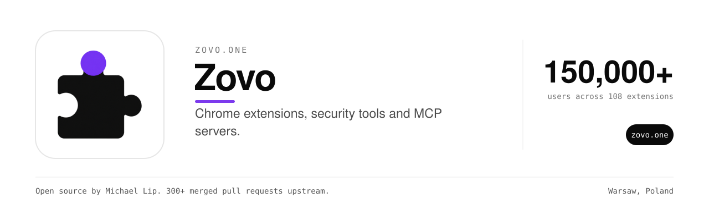

Zovo makes Chrome extensions that do one job and stay out of the way.
There are 108 of them, used by 150,000+ people.
Data stays on the device unless a feature needs a server. Permissions stay as small as the feature allows.

This organization holds the open source parts. The extensions, the tools we use to check what extensions can do, and the MCP servers we run at [mcp.zovo.one](https://mcp.zovo.one).

### Extensions

| Repository | What it does |
| --- | --- |
| [tab-suspender-chrome-extension](https://github.com/theluckystrike/tab-suspender-chrome-extension) | Suspends inactive tabs to free memory. Manifest V3, no tracking. MIT. |
| [zovo-redact](https://github.com/theluckystrike/zovo-redact) | Checks what you are about to paste into an AI chat and redacts it locally first. |
| [cookie-manager-chrome-extension](https://github.com/theluckystrike/cookie-manager-chrome-extension) | View, edit and export cookies per site. Privacy first. |
| [zovo-translate](https://github.com/zovo-one/zovo-translate) | Page, hover, PDF and subtitle translation with a synced glossary. |

### Extension security

Tools that read a Chrome extension and say what it can see. They power the scanner on zovo.one.

| Repository | Language | What it does |
| --- | --- | --- |
| [crx-manifest-parser](https://github.com/theluckystrike/crx-manifest-parser) | Go | Parses MV2 and MV3 manifest.json files. |
| [permission-auditor](https://github.com/theluckystrike/permission-auditor) | Go | Scores permission and host risk. |
| [crx-permission-risk](https://github.com/zovo-one/crx-permission-risk) | Rust | Sorts permissions into risk tiers. |
| [extension-watch](https://github.com/theluckystrike/extension-watch) | TypeScript | Tells a team the day an extension update asks for more access. |

### Build your own extension

[chrome-extension-toolkit](https://github.com/theluckystrike/chrome-extension-toolkit), [zovo-extension-template](https://github.com/zovo-one/zovo-extension-template), [zovo-types-webext](https://github.com/zovo-one/zovo-types-webext), [webext-storage](https://github.com/theluckystrike/webext-storage) and [webext-messaging](https://github.com/theluckystrike/webext-messaging). TypeScript first and MV3 native.

### MCP servers

Local-first MCP servers for back-office work. Invoices, PDFs, spreadsheets, time tracking and expenses, from Claude Desktop, Claude Code or Cursor.
Start at [mcp-servers](https://github.com/theluckystrike/mcp-servers). Each server also has its own repository, such as [mcp-invoice-generator](https://github.com/zovo-one/mcp-invoice-generator), [mcp-pdf](https://github.com/zovo-one/mcp-pdf) and [mcp-three-way-match](https://github.com/zovo-one/mcp-three-way-match).

### Maintained forks

Some Zovo extensions build on open source work by others. Each keeps its upstream license and credits the original project in its README.
[zovo-shield](https://github.com/zovo-one/zovo-shield) builds on uBlock Origin Lite. [zovo-pagevault](https://github.com/zovo-one/zovo-pagevault) builds on SingleFile.

### Repositories

| Repository | What it does |
| --- | --- |
| [zovo-tools](https://github.com/zovo-one/zovo-tools) | Free online tools by Zovo - calculators, generators, and productivity tools |
| [crxpermrisk](https://github.com/zovo-one/crxpermrisk) | Risk scoring for browser extension permissions |
| [ext-permissions-risk](https://github.com/zovo-one/ext-permissions-risk) | Tiny dependency-free Chrome MV3 extension permission risk scorer (TypeScript / JSR). Risk model from zovo.one. |
| [mcp-amortization](https://github.com/zovo-one/mcp-amortization) | Model Context Protocol (MCP) server for loan and lease amortization schedules. Loan and lease schedules from the terms of the agreement, to the minor unit. Works with Claude Desktop, Claude Code and Cursor. |
| [mcp-asset-register](https://github.com/zovo-one/mcp-asset-register) | Model Context Protocol (MCP) server for a fixed asset register with depreciation schedules. A fixed asset register that depreciates on the rates the tax authorities actually publish, with the schedule, the journal and the gain on sale. Works with Claude Desktop, Claude Code and Cursor. |
| [mcp-backlink-checker](https://github.com/zovo-one/mcp-backlink-checker) | Model Context Protocol (MCP) server for a backlink checker: does a page link to your domain, dofollow or nofollow, anchor text and robots guards. Backlink checks from Claude or Cursor: dofollow or nofollow, anchor text, HTTP status and robots guards. Works with Claude Desktop, Claude Code and Cursor. |
| [mcp-bank-statement](https://github.com/zovo-one/mcp-bank-statement) | Model Context Protocol (MCP) server for reading bank statement CSV exports to read, categorise and reconcile transactions. Bank CSV exports categorised, summarised and reconciled with expenses. Works with Claude Desktop, Claude Code and Cursor. |
| [mcp-barcode](https://github.com/zovo-one/mcp-barcode) | Model Context Protocol (MCP) server for QR code and barcode generation: generates barcodes and QR codes. QR codes and barcodes drawn on your machine, with no upload and no network call. Works with Claude Desktop, Claude Code and Cursor. |
| [mcp-bill-of-sale](https://github.com/zovo-one/mcp-bill-of-sale) | Model Context Protocol (MCP) server for a bill of sale generator: bills of sale for vehicles, equipment and stock with signature lines. Record a sale of equipment, a vehicle or stock and get a printable bill of sale with signature lines. Works with Claude Desktop, Claude Code and Cursor. |
| [mcp-billing-docs](https://github.com/zovo-one/mcp-billing-docs) | Model Context Protocol (MCP) server for credit notes and purchase orders. Credit notes and purchase orders, on the same engine as your invoices. Works with Claude Desktop, Claude Code and Cursor. |
| [mcp-budget](https://github.com/zovo-one/mcp-budget) | MCP server: budget — AI-friendly budget tools from Claude or any MCP client |
| [mcp-calendar](https://github.com/zovo-one/mcp-calendar) | Model Context Protocol (MCP) server for reading ics calendars, free busy time and scheduling conflicts. Read .ics calendars: events, free and busy, conflicts, exports. Works with Claude Desktop, Claude Code and Cursor. |
| [mcp-cash-book](https://github.com/zovo-one/mcp-cash-book) | Model Context Protocol (MCP) server for double entry bookkeeping and a cash book general ledger for a small business. One double-entry ledger derived from the books you already keep, proved to the minor unit. Works with Claude Desktop, Claude Code and Cursor. |
| [mcp-catalogue](https://github.com/zovo-one/mcp-catalogue) | Model Context Protocol (MCP) server for a product price list and rate card. One price list and one rate card, kept where the invoice and the quote can both read them. Works with Claude Desktop, Claude Code and Cursor. |
| [mcp-change-order](https://github.com/zovo-one/mcp-change-order) | Model Context Protocol (MCP) server for change orders and contract variations. Change orders against a quote or a work order, with the running contract value derived from what the client approved. Works with Claude Desktop, Claude Code and Cursor. |

84 more repositories

| Repository | What it does |
| --- | --- |
| [mcp-checklist](https://github.com/zovo-one/mcp-checklist) | Model Context Protocol (MCP) server for reusable checklists and dated runs of them: pass, fail, not applicable, and a sign-off. Checklists you build once and run many times, and the dated record of each run that somebody signs. Works with Claude Desktop, Claude Code and Cursor. |
| [mcp-clauses](https://github.com/zovo-one/mcp-clauses) | Model Context Protocol (MCP) server for a searchable contract clause library. Reusable contract clauses, searched and assembled into Word. Works with Claude Desktop, Claude Code and Cursor. |
| [mcp-credit-note](https://github.com/zovo-one/mcp-credit-note) | Model Context Protocol (MCP) server for credit notes and credit memos against an invoice or standalone. Credit notes against an invoice or standalone: drafts, finalization, rendering and totals, all in integer minor units. Works with Claude Desktop, Claude Code and Cursor. |
| [mcp-currency](https://github.com/zovo-one/mcp-currency) | Model Context Protocol (MCP) server for currency conversion: convert currencies with a currency converter on real ECB exchange rates. ECB reference rates: convert, history, and fx_rates for rebilling. Works with Claude Desktop, Claude Code and Cursor. |
| [mcp-delivery-schedule](https://github.com/zovo-one/mcp-delivery-schedule) | Model Context Protocol (MCP) server for delivery schedules, milestones and due dates: produces a dated delivery schedule document. Dated deliverables against a quote or a work order, and what is late as at any date you name. Works with Claude Desktop, Claude Code and Cursor. |
| [mcp-deposits](https://github.com/zovo-one/mcp-deposits) | Model Context Protocol (MCP) server for security and retainer deposits. Security and retainer deposits, held per client, on the same engine as your invoices. Works with Claude Desktop, Claude Code and Cursor. |
| [mcp-docx](https://github.com/zovo-one/mcp-docx) | Model Context Protocol (MCP) server for Word documents: creating docx files, and create a Word document from a chat. Real Word documents from chat: proposals, contracts, quotes. Works with Claude Desktop, Claude Code and Cursor. |
| [mcp-dunning-letters](https://github.com/zovo-one/mcp-dunning-letters) | Model Context Protocol (MCP) server for dunning letters and overdue invoice payment reminders: reminder, final notice and aging. Chase overdue invoices on a ladder anchored to the due date: reminder 1, reminder 2, the final notice, with the aging and the day's chase list. Works with Claude Desktop, Claude Code and Cursor. |
| [mcp-duplicate-invoice-check](https://github.com/zovo-one/mcp-duplicate-invoice-check) | Model Context Protocol (MCP) server for duplicate supplier invoice and vendor bills review: supplied-batch exact and normalized references with free CSV evidence. Review duplicate supplier invoice candidates in supplied local history. Works with Claude Desktop, Claude Code and Cursor. |
| [mcp-ecosystem-measurements](https://github.com/zovo-one/mcp-ecosystem-measurements) | Reproducible measurements of the MCP registry, the VS Code gallery, Glama, hosted MCP server endpoints and GitHub search. Twelve findings, each with the script, its raw dated output and its limitations. |
| [mcp-expense-tracker](https://github.com/zovo-one/mcp-expense-tracker) | Model Context Protocol (MCP) server for expense tracking: track business expenses, receipts and mileage with an expense tracker. Receipts, mileage and expenses that turn into invoice lines. Works with Claude Desktop, Claude Code and Cursor. |
| [mcp-goods-receipt](https://github.com/zovo-one/mcp-goods-receipt) | Model Context Protocol (MCP) server for goods receipt notes against purchase orders: units received, damaged and short, with a discrepancy report. The receiving record for purchase orders: what arrived, against which line, in what quantity and condition. Works with Claude Desktop, Claude Code and Cursor. |
| [mcp-image](https://github.com/zovo-one/mcp-image) | Model Context Protocol (MCP) server for image resizing, conversion, compression and watermarking. Resize, convert, compress and watermark images, pure JavaScript. Works with Claude Desktop, Claude Code and Cursor. |
| [mcp-job-card](https://github.com/zovo-one/mcp-job-card) | Model Context Protocol (MCP) server for job cards for trades and field service: hours and materials per job. One card per job: hours and materials logged against it, a status machine from open to invoiced, and the printed card for client sign-off. Works with Claude Desktop, Claude Code and Cursor. |
| [mcp-kanban](https://github.com/zovo-one/mcp-kanban) | Model Context Protocol (MCP) server for a kanban task board and project board. A task board per project that hands off to the time tracker. Works with Claude Desktop, Claude Code and Cursor. |
| [mcp-leave](https://github.com/zovo-one/mcp-leave) | Model Context Protocol (MCP) server for a staff leave and PTO tracker: requests, approvals, balances, who is out and a calendar export. Employee leave and PTO: balances, approvals, calendars, and who-is-out summaries. Works with Claude Desktop, Claude Code and Cursor. |
| [mcp-loan-calculator](https://github.com/zovo-one/mcp-loan-calculator) | MCP server: loan-calculator — AI-friendly loan-calculator tools from Claude or any MCP client |
| [mcp-maintenance-log](https://github.com/zovo-one/mcp-maintenance-log) | Model Context Protocol (MCP) server for an equipment maintenance log and schedule: service entries, costs, and what is due or overdue. Equipment maintenance log: assets, service entries with costs, and a due report computed from stored dates. Works with Claude Desktop, Claude Code and Cursor. |
| [mcp-mileage-log](https://github.com/zovo-one/mcp-mileage-log) | Model Context Protocol (MCP) server for a mileage log for deductible driving: trips, effective-dated rates, summaries and a CSV export. Mileage log for deductible driving: trips, effective-dated rates, summaries and CSV export. Works with Claude Desktop, Claude Code and Cursor. |
| [mcp-office-suite](https://github.com/zovo-one/mcp-office-suite) | Model Context Protocol (MCP) server for small business accounting and paperwork: invoices, PDFs, spreadsheets, Word documents, time tracking and expenses. One local config entry for invoicing, documents, time tracking and supplier checks. Works with Claude Desktop, Claude Code and Cursor. |
| [mcp-onboarding](https://github.com/zovo-one/mcp-onboarding) | Model Context Protocol (MCP) server for a new-hire onboarding planner: hire records, role templates, task owners and due dates. New-hire onboarding as role-based task templates, with a dated checklist per hire that HR and the manager both read. Works with Claude Desktop, Claude Code and Cursor. |
| [mcp-packing-list](https://github.com/zovo-one/mcp-packing-list) | Model Context Protocol (MCP) server for packing slips and packing lists: cartons, contents, weights, chargeable weight and what is still to pack. Packing slips that carry no prices: what is in each carton, what it weighs, and what is still to pack. Works with Claude Desktop, Claude Code and Cursor. |
| [mcp-payroll](https://github.com/zovo-one/mcp-payroll) | MCP server: payroll — AI-friendly payroll tools from Claude or any MCP client |
| [mcp-per-diem](https://github.com/zovo-one/mcp-per-diem) | Model Context Protocol (MCP) server for per diem travel allowances. Statutory travel allowances on the rate tables the tax authorities publish, and the trips you priced with them. Works with Claude Desktop, Claude Code and Cursor. |
| [mcp-petty-cash](https://github.com/zovo-one/mcp-petty-cash) | Model Context Protocol (MCP) server for a petty cash book and voucher ledger: a cash float on the imprest system. A petty cash float on the imprest system, reconciled to the minor unit. Works with Claude Desktop, Claude Code and Cursor. |
| [mcp-pomodoro](https://github.com/zovo-one/mcp-pomodoro) | MCP server: pomodoro — AI-friendly pomodoro tools from Claude or any MCP client |
| [mcp-price-tracker](https://github.com/zovo-one/mcp-price-tracker) | Model Context Protocol (MCP) server for price tracking, a price tracker and price drop watcher for shop pages. Check and watch product prices on ordinary shop pages. Works with Claude Desktop, Claude Code and Cursor. |
| [mcp-purchase-requisition](https://github.com/zovo-one/mcp-purchase-requisition) | Model Context Protocol (MCP) server for purchase requisitions you build once and approve per order, with the signed record of each approval. Purchase requisitions you build once and approve per order, with the signed record of each approval. Works with Claude Desktop, Claude Code and Cursor. |
| [mcp-quotes](https://github.com/zovo-one/mcp-quotes) | Model Context Protocol (MCP) server for quote-to-invoice conversion: create price quotes, estimates and proposals, then convert an accepted quote to an invoice. Priced, VAT-correct quotes from chat, and the yes turns into an invoice. Works with Claude Desktop, Claude Code and Cursor. |
| [mcp-receipts](https://github.com/zovo-one/mcp-receipts) | MCP server: receipts — AI-friendly receipts tools from Claude or any MCP client |
| [mcp-recurring](https://github.com/zovo-one/mcp-recurring) | Model Context Protocol (MCP) server for recurring invoices and subscription billing: handles scheduled invoice documents. Scheduled invoices, generated into your invoice book with PDFs. Works with Claude Desktop, Claude Code and Cursor. |
| [mcp-resume](https://github.com/zovo-one/mcp-resume) | Model Context Protocol (MCP) server for resume and cover letter writing, CV documents in Word format. Resumes and cover letters as Word files from one profile, never invented. Works with Claude Desktop, Claude Code and Cursor. |
| [mcp-service-agreement](https://github.com/zovo-one/mcp-service-agreement) | Model Context Protocol (MCP) server for service agreements for freelancers: scope, deliverables, rate, termination and liability, rendered for signing. Service agreements for freelancers: scope, deliverables, rate, termination and liability, rendered for signing. Works with Claude Desktop, Claude Code and Cursor. |
| [mcp-spreadsheet](https://github.com/zovo-one/mcp-spreadsheet) | Model Context Protocol (MCP) server for spreadsheets: read, query, edit and convert xlsx, csv and Excel files, and builds a new spreadsheet from rows in a chat. Read, query, edit and convert xlsx and csv files safely. Works with Claude Desktop, Claude Code and Cursor. |
| [mcp-statement-of-account](https://github.com/zovo-one/mcp-statement-of-account) | Model Context Protocol (MCP) server for customer statements of account, accounts receivable and invoice aging. The one document that answers what a client actually owes you, aged as at any date, with the chaser drafted. Works with Claude Desktop, Claude Code and Cursor. |
| [mcp-stripe-billing](https://github.com/zovo-one/mcp-stripe-billing) | MCP server: stripe-billing — AI-friendly stripe-billing tools from Claude or any MCP client |
| [mcp-supplier-list](https://github.com/zovo-one/mcp-supplier-list) | Model Context Protocol (MCP) server for a supplier directory that does not rot: contacts, payment terms, lead times and review stamps. A supplier directory that does not rot: contacts, terms, lead times, and when each record was last reviewed. Works with Claude Desktop, Claude Code and Cursor. |
| [mcp-supplier-statement-check](https://github.com/zovo-one/mcp-supplier-statement-check) | Model Context Protocol (MCP) server for supplier statement and vendor statement open-item reconciliation checks against a supplied accounts payable ledger, with exact reference evidence. Compare supplied supplier statement and AP ledger open items, with complete exact-key evidence. Works with Claude Desktop, Claude Code and Cursor. |
| [mcp-tax-calc](https://github.com/zovo-one/mcp-tax-calc) | MCP server: tax-calc — AI-friendly tax-calc tools from Claude or any MCP client |
| [mcp-time-tracker](https://github.com/zovo-one/mcp-time-tracker) | Model Context Protocol (MCP) server for time tracking: timesheets, a timesheet and a billable hours tracker. Track billable time without leaving the chat. Works with Claude Desktop, Claude Code and Cursor. |
| [mcp-timezone](https://github.com/zovo-one/mcp-timezone) | Model Context Protocol (MCP) server for timezone conversion and meeting planning: schedule a meeting across time zones. Find meeting slots inside everyone's working hours. Works with Claude Desktop, Claude Code and Cursor. |
| [mcp-work-order](https://github.com/zovo-one/mcp-work-order) | Model Context Protocol (MCP) server for work orders and job cards for trades and field service. Job orders for trades and field work, priced the way the invoice will be. Works with Claude Desktop, Claude Code and Cursor. |
| [mcp-zip](https://github.com/zovo-one/mcp-zip) | Model Context Protocol (MCP) server for zip archives: create, inspect and extract. Make a zip, look inside one, and unpack one, entirely on your machine. Works with Claude Desktop, Claude Code and Cursor. |
| [mv3-tab-suspender](https://github.com/zovo-one/mv3-tab-suspender) | MV3 Chrome extension starter template — auto-suspend inactive tabs |
| [mv3permrisk](https://github.com/zovo-one/mv3permrisk) | Score the privacy/security risk of a Chrome MV3 extension from its declared permissions (D library) |
| [telegram-anonymous-group-post-bot](https://github.com/zovo-one/telegram-anonymous-group-post-bot) | Anonymous posting bot for Telegram groups — post anonymously into a Telegram group through the bot. |
| [telegram-anonymous-inbox-bot](https://github.com/zovo-one/telegram-anonymous-inbox-bot) | Anonymous message telegram bot with a link — a personal link where strangers write to you anonymously; you reply and can block. |
| [telegram-birthday-reminder-bot](https://github.com/zovo-one/telegram-birthday-reminder-bot) | Telegram birthday reminder bot for groups — members save their birthday once; the bot greets them in the group and warns everyone else the day before. |
| [telegram-countdown-bot](https://github.com/zovo-one/telegram-countdown-bot) | Telegram countdown bot for group chats — a countdown message that updates itself automatically, right inside the group. |
| [telegram-expense-tracker-bot](https://github.com/zovo-one/telegram-expense-tracker-bot) | Telegram expense tracker bot for your DMs — text an expense, get it logged and categorized automatically. |
| [telegram-group-activity-stats-bot](https://github.com/zovo-one/telegram-group-activity-stats-bot) | Group activity stats bot for Telegram — activity stats for Telegram groups — counts messages, never content. |
| [telegram-habit-tracker-bot](https://github.com/zovo-one/telegram-habit-tracker-bot) | Habit tracker telegram bot with streaks — habits with tap check-ins, streaks, a once-a-day prompt, and a Mini App board. |
| [telegram-icebreaker-question-bot](https://github.com/zovo-one/telegram-icebreaker-question-bot) | Icebreaker bot for Telegram groups — one conversation-starter a day, posted to the group automatically. |
| [telegram-locked-message-bot](https://github.com/zovo-one/telegram-locked-message-bot) | Telegram secret message bot for any chat — a locked message only one person can open, posted inline into any chat. |
| [telegram-party-games-bot](https://github.com/zovo-one/telegram-party-games-bot) | Truth or dare party game bot for Telegram — truth/dare/would-you-rather/never-have-I-ever prompts with no-repeat rounds. |
| [telegram-pomodoro-bot](https://github.com/zovo-one/telegram-pomodoro-bot) | Telegram pomodoro bot for focus sessions — a focus timer with an end message and break, solo by DM or together in a group. |
| [telegram-reminder-bot](https://github.com/zovo-one/telegram-reminder-bot) | Telegram reminder bot for any group chat — reminders delivered in chat by a 1-minute cron, in your own timezone. |
| [telegram-rsvp-event-bot](https://github.com/zovo-one/telegram-rsvp-event-bot) | Event RSVP bot for Telegram groups — group events with Going/Maybe/Can't buttons, live counts, and 1-hour reminders. |
| [telegram-secret-santa-bot](https://github.com/zovo-one/telegram-secret-santa-bot) | Secret Santa telegram bot for groups — Secret Santa for a Telegram group: join, draw, and matches sent by DM. |
| [telegram-split-bill-bot](https://github.com/zovo-one/telegram-split-bill-bot) | Split bill telegram bot for group expenses — group expense ledger: add expenses, see balances, minimal settlement, CSV export. |
| [telegram-standup-bot](https://github.com/zovo-one/telegram-standup-bot) | Async standup bot for Telegram groups — async daily standup: the bot DMs 3 questions, then posts one compiled report to the group. |
| [telegram-time-tracking-bot](https://github.com/zovo-one/telegram-time-tracking-bot) | Freelancer time tracker bot for Telegram — clock in/out or log hours by DM, totaled per client. |
| [telegram-time-zone-bot](https://github.com/zovo-one/telegram-time-zone-bot) | Timezone converter bot for Telegram — time-zone converter for Telegram groups and inline use, DST-correct. |
| [telegram-trivia-bot](https://github.com/zovo-one/telegram-trivia-bot) | Telegram trivia bot for group quiz polls — one daily trivia question as a native quiz poll, with a weekly group leaderboard. |
| [telegram-vocabulary-bot](https://github.com/zovo-one/telegram-vocabulary-bot) | Spaced repetition telegram bot for vocabulary — one spaced-repetition vocabulary card a day, by DM, from a 300-word English catalog. |
| [zovo-ai-cockpit](https://github.com/zovo-one/zovo-ai-cockpit) | Zovo AI Cockpit — one cockpit for Gemini, ChatGPT, Claude & Grok: prompt library, chat search, token/cost estimator, side-by-side comparison. GPL-3.0 fork of Nagi-ovo/voyager. |
| [zovo-content](https://github.com/zovo-one/zovo-content) | Zovo marketing content, blog posts, SEO pages |
| [zovo-fleet-v4](https://github.com/zovo-one/zovo-fleet-v4) | Zovo Fleet v4.0 — Multi-agent orchestration system for npm packages, Chrome extension templates, and open-source contributions |
| [zovo-fluent](https://github.com/zovo-one/zovo-fluent) | GPL-3.0 immersion reader with click-captured SRS vocabulary and bilingual captions |
| [zovo-gallery-saver](https://github.com/zovo-one/zovo-gallery-saver) | GPL gallery image saver with site-neutral discovery, resilient queues, filename rules, and bandwidth control. |
| [zovo-gauge](https://github.com/zovo-one/zovo-gauge) | DOM-only pre-watch engagement filter for Chrome (GPL-3.0) |
| [zovo-indexer](https://github.com/zovo-one/zovo-indexer) | Zovo search indexer and crawler |
| [zovo-lean](https://github.com/zovo-one/zovo-lean) | GPL-3.0 MV3 bandwidth and speed saver fork of gorhill/uBlock |
| [zovo-matrix](https://github.com/zovo-one/zovo-matrix) | Matrix terminal theme for macOS/zsh + Privacy Shield Chrome extension / Built by Zovo |
| [zovo-media-sniffer](https://github.com/zovo-one/zovo-media-sniffer) | Zovo Media Sniffer — GPL-3.0 fork of xifangczy/cat-catch: media sniffer with refusal policy (YouTube/DRM), batch queue, on-device HLS merge |
| [zovo-permissions-scanner](https://github.com/zovo-one/zovo-permissions-scanner) | Chrome extension permissions scanner — privacy/security grading engine. Know what your extensions can see. |
| [zovo-ratio](https://github.com/zovo-one/zovo-ratio) | GPL-3.0 YouTube sentiment fork with ratio, channel history, list badges, and CSV export |
| [zovo-recorder](https://github.com/zovo-one/zovo-recorder) | Private local-first Chrome screen recorder with editing, annotations, webcam presets, GIF/WebM export, and chapters. GPL-3.0. |
| [zovo-skiplist](https://github.com/zovo-one/zovo-skiplist) | Personal video skip bookmarks, category profiles, podcast rules, and listening-time stats — GPL SponsorBlock fork without community API access |
| [zovo-streamscope](https://github.com/zovo-one/zovo-streamscope) | Passive per-tab media inspector for stream URLs and live page players (GPL-3.0) |
| [zovo-styles](https://github.com/zovo-one/zovo-styles) | Zovo Styles — redesign the web with user styles (GPL-3.0 fork of openstyles/stylus). Zero telemetry. Curated starter themes, per-site dark/light switcher, one-click backup, Pro editor tools. |
| [zovo-themer](https://github.com/zovo-one/zovo-themer) | No-code visual website theming with scoped rules and portable user.css export |
| [zovo-threads](https://github.com/zovo-one/zovo-threads) | Keyboard-first Reddit threads with local tags, filters, media controls, and read-position memory. |
| [zovo-trim](https://github.com/zovo-one/zovo-trim) | Personal offline skip and mute regions for HTML5 video |

### Maintainer

Built and maintained by [Michael Lip](https://github.com/theluckystrike) in Warsaw, Poland.
He also fixes bugs in projects he uses. He has 300+ merged pull requests in 200+ outside repositories, including [urllib3](https://github.com/urllib3/urllib3/pull/5330), [Appium](https://github.com/appium/appium/pull/22911), [Prefect](https://github.com/PrefectHQ/prefect/pull/21916) and [Google Chrome extension samples](https://github.com/GoogleChrome/chrome-extensions-samples/pull/1629).
Need an engineer for your own product or AI agent? Send a written brief at [axdale.com](https://www.axdale.com/?utm_source=github&utm_medium=org&utm_campaign=hire&utm_content=zovo-one).
